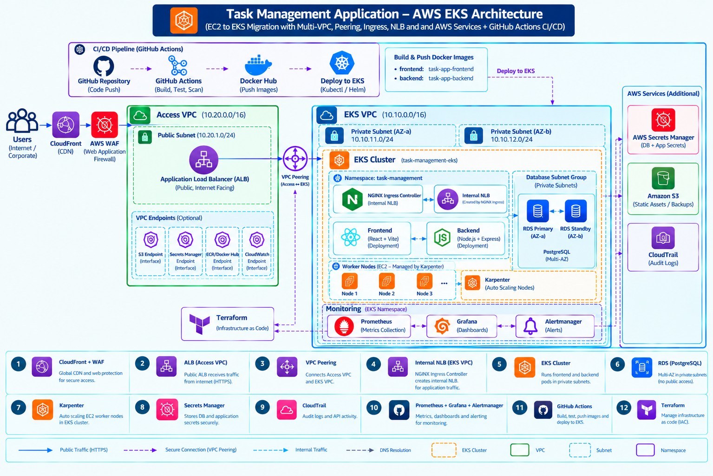

<div align="center">

# 📝 Task Management App on Amazon EKS

### Cloud-Native 3-Tier Task Management Platform

A full-stack task management application built with **React, Node.js, Express, PostgreSQL, Docker, Kubernetes, and Amazon EKS**. The platform uses Amazon RDS for PostgreSQL, AWS networking and IAM, AWS Load Balancer Controller, Karpenter, and an observability stack based on Prometheus, Grafana, Alertmanager, Loki, and Grafana Alloy.

[](https://react.dev/)
[](https://vitejs.dev/)
[](https://nodejs.org/)
[](https://expressjs.com/)
[](https://www.postgresql.org/)
[](https://www.docker.com/)
[](https://aws.amazon.com/eks/)
[](https://www.terraform.io/)
[](https://prometheus.io/)
[](https://grafana.com/)

</div>

---

## 📌 Table of Contents

- [Project Overview](#-project-overview)
- [Application Features](#-application-features)
- [Architecture](#️-architecture)
- [Technology Stack](#-technology-stack)
- [Project Structure](#-project-structure)
- [AWS Environment](#-aws-environment)
- [Prerequisites](#-prerequisites)
- [Local Docker Setup](#-local-docker-setup)
- [Connect to Amazon EKS](#-connect-to-amazon-eks)
- [Deploy the Application](#-deploy-the-application)
- [Configuration and Secrets](#-configuration-and-secrets)
- [Ingress and Internal ALB](#-ingress-and-internal-alb)
- [RDS PostgreSQL Migration and Connectivity](#-rds-postgresql-migration-and-connectivity)
- [Monitoring and Observability](#-monitoring-and-observability)
- [Karpenter and Node Autoscaling](#-karpenter-and-node-autoscaling)
- [Troubleshooting](#-troubleshooting)
- [Security](#-security)
- [Useful Commands](#-useful-commands)
- [Project Status and Future Improvements](#-project-status-and-future-improvements)
- [Author](#-author)

---

## 🚀 Project Overview

**Task Management App** is a full-stack task management and team collaboration platform. Users can authenticate and create, update, delete, and manage tasks.

The project started as a Dockerized application and was deployed to Kubernetes. The AWS deployment uses **Amazon EKS** to orchestrate the frontend and backend containers and **Amazon RDS for PostgreSQL** as the managed relational database.

The project demonstrates cloud-native and DevOps practices including containerization, Kubernetes workloads, AWS VPC networking, database migration, ingress routing, workload monitoring, centralized pod logging, and EC2 node provisioning with Karpenter.

## ✨ Application Features

- User login and authentication
- Create, view, update, and delete tasks
- Mark tasks as completed or incomplete
- User management
- React frontend served by Nginx
- Node.js and Express REST API
- PostgreSQL data persistence
- Backend health, readiness, and Prometheus metrics endpoints

---

## 🏗️ Architecture
<!-- Place your architecture image at images/architecture.png in the repository. -->


### Amazon EKS Multi-VPC Architecture

```text
                         EXTERNAL USERS
                              |
                              v
                    +----------------------+
                    |   Amazon CloudFront  |
                    |   Content Delivery   |
                    +----------------------+
                              |
                              v
                    +----------------------+
                    |       AWS WAF        |
                    |     Web Application  |
                    |       Firewall       |
                    +----------------------+
                              |
                              v
       +------------------------------------------------+
       |          ACCESS / EXTERNAL VPC                 |
       |             10.20.0.0/16                       |
       |                                                |
       |  +------------------------------------------+  |
       |  |       Internet-Facing ALB                |  |
       |  |    Application Load Balancer             |  |
       |  +------------------------------------------+  |
       |                                                |
       |  +------------------------------------------+  |
       |  |          Ubuntu EC2 Instance             |  |
       |  |           Access / Testing               |  |
       |  +------------------------------------------+  |
       +------------------------------------------------+
                              |
                              |
                    VPC PEERING CONNECTION
                              |
                              v
       +------------------------------------------------+
       |                   EKS VPC                     |
       |                10.10.0.0/16                    |
       |                                                |
       |  +------------------------------------------+  |
       |  |          Amazon EKS Cluster              |  |
       |  |         task-management-eks              |  |
       |  |                                          |  |
       |  |  +------------------------------------+  |  |
       |  |  |            Internal NLB            |  |  |
       |  |  |      Network Load Balancer         |  |  |
       |  |  +------------------------------------+  |  |
       |  |                    |                     |  |
       |  |                    v                     |  |
       |  |  +------------------------------------+  |  |
       |  |  |       Kubernetes Ingress           |  |  |
       |  |  |         Ingress-NGINX              |  |  |
       |  |  +------------------------------------+  |  |
       |  |                    |                     |  |
       |  |                    v                     |  |
       |  |  +------------------------------------+  |  |
       |  |  |         Frontend Service           |  |  |
       |  |  |          React + Nginx             |  |  |
       |  |  +------------------------------------+  |  |
       |  |                    |                     |  |
       |  |                    v                     |  |
       |  |  +------------------------------------+  |  |
       |  |  |          Backend Service           |  |  |
       |  |  |        Node.js + Express           |  |  |
       |  |  +------------------------------------+  |  |
       |  +------------------------------------------+  |
       +------------------------------------------------+
                              |
                              | PostgreSQL / TLS
                              v
       +------------------------------------------------+
       |                   RDS VPC                     |
       |                172.31.0.0/16                   |
       |                                                |
       |  +------------------------------------------+  |
       |  |       Amazon RDS PostgreSQL              |  |
       |  |                                          |  |
       |  |       Database: task_management          |  |
       |  +------------------------------------------+  |
       +------------------------------------------------+
```

> **Architecture Notes**
>
> - **Amazon CloudFront:** Content delivery and external application entry point.
> - **AWS WAF:** Web application firewall for filtering and protecting web traffic.
> - **Internet-Facing ALB:** Receives external HTTP/HTTPS traffic in the Access VPC (`10.20.0.0/16`).
> - **Access VPC:** Contains the Internet-Facing ALB and Ubuntu EC2 instance used for access and testing.
> - **VPC Peering:** Connects the Access VPC (`10.20.0.0/16`) and EKS VPC (`10.10.0.0/16`).
> - **Amazon EKS:** Runs the application workloads in the `task-management` namespace.
> - **Internal NLB:** Provides internal network load balancing for configured targets.
> - **Kubernetes Ingress:** Routes application traffic to the appropriate Kubernetes services.
> - **Frontend:** React application served through Nginx.
> - **Backend:** Node.js and Express API.
> - **Amazon RDS:** Hosts the PostgreSQL database `task_management` in the RDS VPC (`172.31.0.0/16`).

### EKS Platform and Observability

```text
Amazon EKS: task-management-eks
|
+-- Namespace: task-management
|   +-- frontend Deployment / Pods
|   +-- backend Deployment / Pods
|   +-- frontend-service
|   +-- backend-service
|   +-- task-app-ingress
|
+-- Monitoring namespace (verify actual namespace)
|   +-- Prometheus
|   +-- Grafana
|   +-- Alertmanager
|
+-- Namespace: logging
|   +-- Loki
|   +-- Grafana Alloy
|
+-- Karpenter (namespace depends on the installed release)
    +-- NodePool
    +-- EC2NodeClass
    +-- EC2 worker node provisioning
```

### AWS Infrastructure and Audit

```text
AWS Account
|
+-- Amazon EKS
|   +-- VPC and subnets
|   +-- IAM / EKS access
|   +-- Worker nodes
|   +-- AWS Load Balancer Controller
|
+-- Amazon RDS for PostgreSQL
|
+-- AWS CloudTrail
    +-- AWS API activity and account audit events
```

CloudTrail records supported AWS account and API activity; it is not a replacement for application metrics or Kubernetes pod logs. CloudFront, AWS WAF, and AWS Secrets Manager integration are not represented as deployed components here unless they are separately configured and verified.

### Application Request Flow

```text
External User
     |
     v
Amazon CloudFront
     |
     v
AWS WAF
     |
     v
Internet-Facing ALB
(Access VPC: 10.20.0.0/16)
     |
     v
VPC Peering Connection
     |
     v
Internal NLB
(EKS VPC: 10.10.0.0/16)
     |
     v
Kubernetes Ingress
(Ingress-NGINX)
     |
     v
Nginx / React Frontend
     |
     | HTTP API Request
     v
Node.js + Express Backend
     |
     | PostgreSQL over TLS
     v
Amazon RDS PostgreSQL
(RDS VPC: 172.31.0.0/16)
     |
     v
API Response
     |
     v
React UI
```

---

## 🧰 Technology Stack

### Application

| Technology | Purpose |
|---|---|
| React | Frontend UI |
| Vite | Frontend build tool |
| Node.js | Backend runtime |
| Express.js | REST API framework |
| PostgreSQL | Relational database |
| Nginx | Frontend web server and configured reverse proxy |

### Containers, Kubernetes, and AWS

| Technology | Purpose |
|---|---|
| Docker | Containerization |
| Docker Compose | Local multi-container deployment |
| Kubernetes | Container orchestration |
| Amazon EKS | Managed Kubernetes control plane |
| AWS EC2 | Kubernetes worker capacity and administration/test hosts |
| Amazon RDS | Managed PostgreSQL database |
| AWS VPC | Network isolation |
| AWS Security Groups | Network access control |
| AWS IAM | AWS identity and permissions |
| AWS Load Balancer Controller | AWS load balancer integration for Kubernetes |
| Karpenter | Kubernetes node provisioning |
| Terraform | Infrastructure as code for configured resources |
| Kubernetes ConfigMaps and Secrets | Application configuration and sensitive values |

### Observability

| Technology | Purpose |
|---|---|
| Prometheus | Metrics collection and alert-rule evaluation |
| Grafana | Metrics and log visualization |
| Alertmanager | Alert grouping, routing, and notifications |
| Loki | Log storage and querying |
| Grafana Alloy | Telemetry collection, including configured pod logs |
| AWS CloudTrail | AWS account/API audit history |

---

## 📂 Project Structure

The following is a representative structure based on the application and infrastructure folders used in this project. Confirm exact filenames in your current Git branch before running commands.
## 📂 Project Structure

```text
Task-Mgmt-App-EKS/
|
├── backend/
│   ├── config/
│   │   └── db.js
│   ├── controllers/
│   │   ├── authController.js
│   │   ├── taskController.js
│   │   └── userController.js
│   ├── routes/
│   ├── middleware/
│   ├── database/
│   │   ├── schema.sql
│   │   └── seed.sql
│   ├── app.js
│   ├── server.js
│   └── Dockerfile
|
├── frontend/
│   ├── src/
│   ├── public/
│   ├── nginx.conf
│   └── Dockerfile
|
├── kubernetes "terraform.languageServer.enable": true,
    "terraform.languageServer.args": [
        "serve"
    ] "terraform.languageServer.enable": true,
    "terraform.languageServer.args": [
        "serve"
    ]/
│   ├── backend-deployment.yaml
│   ├── backend-service.yaml
│   ├── frontend-deployment.yaml
│   ├── frontend-service.yaml
│   └── ...
|
├── terraform/
│   └── Terraform configuration for AWS infrastructure
|
├── aws-secret-manager/
│   └── AWS Secrets Manager configuration
|
├── Karpenter/
│   └── Terraform configuration for Karpenter
|
├── monitoring/
│   ├── monitoring-value.yaml
│   ├── service-monitoring.yaml
│   ├── ingress-monitoring.yaml
│   └── looki/
│       └── alloy-values.yaml
|
├── docker-compose.yml
├── kind-config.yaml
├── .gitignore
└── README.md
```

---

## ☁️ AWS Environment

| Setting | Project value |
|---|---|
| EKS cluster | `task-management-eks` |
| AWS Region | `ap-south-1` |
| Application namespace | `task-management` |
| Database engine | Amazon RDS for PostgreSQL |
| Database name | `task_management` |
| PostgreSQL port | `5432` |
| Backend port | `5000` |
| Frontend container port | `80` |
| EKS VPC CIDR | `10.10.0.0/16` |
| Access VPC CIDR | `10.20.0.0/16` |

The EKS VPC and RDS VPC must have a valid network path. The RDS endpoint in this project has also been associated with the default VPC (`172.31.0.0/16`) during testing, so verify the **current RDS VPC and endpoint** before applying network rules. VPC peering is not transitive; a peering connection to another VPC does not automatically provide access to a database in a third VPC.

For RDS connectivity, configure routes and security groups for the actual network path used by the EKS workload. Do not expose PostgreSQL to `0.0.0.0/0`.

---

## ✅ Prerequisites

Install or configure the following tools on an Ubuntu workstation or administration host:

- AWS CLI v2
- `kubectl`
- Helm
- Docker
- Git
- `psql` client
- Terraform, when working with the Karpenter Terraform configuration

Check tool versions:

```bash
aws --version
kubectl version --client
helm version
docker --version
terraform version
```

### Confirm AWS credentials

```bash
aws sts get-caller-identity
aws configure get region
```

If the identity command returns `InvalidClientTokenId`, an expired-token error, or an access-denied error, fix the credentials or IAM permissions before continuing.

---

## 🐳 Local Docker Setup

The application can also be run locally using Docker Compose.

### 1. Clone the repository

```bash
git clone https://github.com/chouhanpradeep720-ai/Task-Mgmt-App.git
cd Task-Mgmt-App
```

### 2. Configure environment variables

Example values for a local Docker Compose environment:

```env
PORT=5000
DB_HOST=database
DB_PORT=5432
DB_NAME=task_management
DB_USER=postgres
DB_PASSWORD=replace-with-a-local-password
```

Use the variable names expected by the application. Do not commit real passwords, JWT secrets, AWS credentials, or API keys.

### 3. Start the application

```bash
docker compose up -d --build
```

### 4. Verify containers and logs

```bash
docker ps
docker compose ps
docker compose logs -f
docker compose logs -f backend
docker compose logs -f database
```

### 5. Stop local containers

```bash
docker compose down
```

---

## ☸️ Connect to Amazon EKS

### 1. Update kubeconfig

```bash
aws eks update-kubeconfig \
  --region ap-south-1 \
  --name task-management-eks
```

### 2. Verify cluster access

```bash
kubectl config current-context
kubectl get nodes -o wide
kubectl get namespaces
```

Confirm that worker nodes are in `Ready` state before deploying workloads.

### 3. Verify application namespace

```bash
kubectl get namespace task-management
kubectl get all -n task-management
```

If the namespace does not exist, create it:

```bash
kubectl create namespace task-management
```

---

## 🚀 Deploy the Application

> Review your current YAML manifests before applying them. The paths below follow the project's representative structure; use the actual paths in your checkout.

### 1. Review application manifests

```bash
find kubernetes/ -maxdepth 2 -type f
```

### 2. Apply application resources

If `kubernetes/` contains only resources intended for the application namespace:

```bash
kubectl apply -f kubernetes/ -n task-management
```

If the folder contains resources for other namespaces, CRDs, or cluster-scoped resources, apply the relevant files individually and in the correct order.

### 3. Verify Deployments, Pods, and Services

```bash
kubectl get deployments -n task-management
kubectl get pods -n task-management -o wide
kubectl get services -n task-management
kubectl get ingress -n task-management
```

### 4. Check rollout status

```bash
kubectl rollout status deployment/frontend-deployment -n task-management
kubectl rollout status deployment/backend-deployment -n task-management
```

### 5. Container images used by the project

The project has used these image references:

```text
Frontend: pradeepchouhan115/task-app-frontend:latest
Backend:  pradeepchouhan115/task-app-backend:1.1
```

Confirm the current deployed image tags:

```bash
kubectl get deployments -n task-management \
  -o custom-columns='NAME:.metadata.name,IMAGES:.spec.template.spec.containers[*].image'
```

Prefer immutable version tags for releases rather than relying on `latest`.

---

## 🔐 Configuration and Secrets

The backend configuration used by this project includes these variable names:

```text
DB_HOST
DB_NAME=task_management
DB_PORT=5432
DB_USER
DB_PASSWORD
PORT=5000
ADMIN_USERNAME
ADMIN_PASSWORD
```

Use a ConfigMap for non-sensitive settings and a Kubernetes Secret for sensitive values. The actual ConfigMap/Secret names and keys must match those referenced by the live Deployment.

### Inspect configuration references

```bash
kubectl get configmaps,secrets -n task-management
kubectl describe deployment backend-deployment -n task-management
```

Do not print or commit secret values.

If you need to create a Secret, use the name referenced by the Deployment. Example only:

```bash
kubectl create secret generic backend-secrets \
  -n task-management \
  --from-literal=DB_PASSWORD='replace-me' \
  --from-literal=ADMIN_PASSWORD='replace-me' \
  --dry-run=client -o yaml | kubectl apply -f -
```

Replace the example name and values with your intended configuration. Avoid placing real credentials in shell history. Kubernetes Secret data is base64-encoded; base64 is not encryption. Use least-privilege RBAC and the cluster's encryption-at-rest controls.

---

## 🌐 Ingress and Internal ALB

The project has used the AWS Load Balancer Controller and an Ingress named `task-app-ingress` in namespace `task-management`. The tested setup used an **internal Application Load Balancer (ALB)**.

### 1. Check the controller

```bash
kubectl get deployment -n kube-system aws-load-balancer-controller
kubectl get pods -n kube-system | grep aws-load-balancer-controller
```

### 2. Inspect Ingress

```bash
kubectl get ingress -n task-management
kubectl describe ingress task-app-ingress -n task-management
```

### 3. Get the ALB hostname

```bash
kubectl get ingress task-app-ingress -n task-management \
  -o jsonpath='{.status.loadBalancer.ingress[0].hostname}{"\n"}'
```

### 4. Check Service endpoints

```bash
kubectl get svc -n task-management
kubectl get endpoints -n task-management
kubectl get pods -n task-management -o wide
```

### Ingress troubleshooting notes

- Ensure `ingressClassName` and annotations match the controller intended to manage the Ingress. Do not accidentally mix the `nginx` ingress class with the AWS ALB ingress class.
- Verify ALB scheme, target type, listener configuration, health-check path, subnet discovery tags, IAM permissions, and backend Service port.
- Check target health in the AWS EC2 console under **Target Groups**.
- An internal ALB is not directly reachable from a normal public browser without private network connectivity, such as VPN or an appropriately connected VPC host.
- A redirect from another load balancer to the internal ALB does not make the internal ALB publicly accessible to arbitrary clients.
- Review security groups and TLS before exposing an application publicly.

---
# 🗄️ RDS Migration --- Task Management App

This guide covers migration from PostgreSQL running in Kubernetes to
Amazon RDS for PostgreSQL in two network scenarios:

## Step : Test RDS DNS Resolution

```bash
nslookup <RDS-ENDPOINT>
```

Example:

```bash
nslookup task-db.xxxxxxxxxxxx.ap-south-1.rds.amazonaws.com
```

Alternative:

```bash
getent hosts <RDS-ENDPOINT>
```

If DNS works, the RDS hostname should resolve to an IP address.

---

## Step : Test PostgreSQL Port

```bash
nc -vz <RDS-ENDPOINT> 5432
```

Example:

```bash
nc -vz task-db.xxxxxxxxxxxx.ap-south-1.rds.amazonaws.com 5432
```

1.  **Option A --- EKS and RDS in the same VPC**
2.  **Option B --- EKS and RDS in different VPCs**

Follow only the scenario that matches the current AWS configuration. The
migration workflow is documented inside both sections.

## Project details

  Component                             Value
  ------------------------------------- -------------------------
  EKS cluster                           `task-management-eks`
  AWS Region                            `ap-south-1`
  Kubernetes namespace                  `task-management`
  Database engine                       PostgreSQL
  Database name                         `task_management`
  PostgreSQL port                       `5432`
  Expected application tables           `users`, `tasks`
  EKS VPC ID previously recorded        `vpc-003d26afe6fad3c3a`
  EKS VPC CIDR previously recorded      `10.10.0.0/16`
  Access VPC CIDR previously recorded   `10.20.0.0/16`
  RDS VPC CIDR previously reported      `172.31.0.0/16`

> **Important:** AWS resources may have changed. Verify the current RDS
> VPC, endpoint, subnets, route tables and security groups before making
> changes. Replace every `YOUR-...` placeholder with a real value. The
> commands below are examples; they do not automatically know your
> account's current resource IDs.

## Architecture

``` text
Kubernetes PostgreSQL
        | pg_dump
        v
    backup.sql
        | kubectl cp
        v
Temporary PostgreSQL client pod in EKS
        | psql over TCP 5432 + TLS
        v
Amazon RDS for PostgreSQL
        |
        v
Task Management backend
```

## Prerequisites and discovery

You need AWS CLI credentials, `kubectl` access to EKS, access to the
source PostgreSQL pod, a destination RDS PostgreSQL instance, and
sufficient disk space for the dump.

``` bash
aws sts get-caller-identity
aws configure get region

aws eks update-kubeconfig \
  --region ap-south-1 \
  --name task-management-eks

kubectl config current-context
kubectl get pods -n task-management
```

Find the RDS endpoint, VPC, status, subnet group and security groups:

``` bash
aws rds describe-db-instances \
  --region ap-south-1 \
  --query 'DBInstances[].{Identifier:DBInstanceIdentifier,Engine:Engine,Status:DBInstanceStatus,Endpoint:Endpoint.Address,Port:Endpoint.Port,VpcId:DBSubnetGroup.VpcId,SubnetGroup:DBSubnetGroup.DBSubnetGroupName,SecurityGroups:VpcSecurityGroups[].VpcSecurityGroupId,PubliclyAccessible:PubliclyAccessible}' \
  --output table
```

Set values from the actual command output:

``` bash
export AWS_REGION="ap-south-1"
export EKS_CLUSTER="task-management-eks"
export DB_NAME="task_management"
export DB_PORT="5432"
export EKS_VPC_ID="vpc-003d26afe6fad3c3a"
export RDS_ENDPOINT="YOUR-RDS-ENDPOINT"
export RDS_VPC_ID="YOUR-RDS-VPC-ID"
export RDS_SG_ID="YOUR-RDS-SECURITY-GROUP-ID"
```

Inspect VPC IDs and CIDRs:

``` bash
aws ec2 describe-vpcs \
  --region "$AWS_REGION" \
  --vpc-ids "$EKS_VPC_ID" "$RDS_VPC_ID" \
  --query 'Vpcs[].{VpcId:VpcId,CIDRs:CidrBlockAssociationSet[].CidrBlock,Name:Tags[?Key==`Name`]|[0].Value}' \
  --output table
```

RDS should be in `available` state. Keep it private where possible.

------------------------------------------------------------------------

# Option A --- Same VPC (EKS and RDS)

Use this option only if the relevant EKS networking and the RDS DB
subnet group are in the **same VPC**. VPC Peering is not needed when
both resources are already in the same VPC.

## A1. Confirm the VPC

``` bash
aws eks describe-cluster \
  --region "$AWS_REGION" \
  --name "$EKS_CLUSTER" \
  --query 'cluster.resourcesVpcConfig.{VpcId:vpcId,SubnetIds:subnetIds,SecurityGroupIds:securityGroupIds}' \
  --output json

aws rds describe-db-instances \
  --region "$AWS_REGION" \
  --query 'DBInstances[].{Identifier:DBInstanceIdentifier,VpcId:DBSubnetGroup.VpcId,Endpoint:Endpoint.Address,SecurityGroups:VpcSecurityGroups[].VpcSecurityGroupId}' \
  --output table
```

Compare the VPC IDs. If they differ, use Option B instead.

## A2. Configure the RDS security group

Allow inbound TCP `5432` from the actual EKS workload source. Prefer an
appropriate EKS node/pod security group where supported; otherwise use
the narrowest correct source CIDR. Check EKS egress and subnet network
ACLs too.

Inspect the RDS security group:

``` bash
aws ec2 describe-security-groups \
  --region "$AWS_REGION" \
  --group-ids "$RDS_SG_ID" \
  --output json
```

Example CIDR-based rule only---set a correctly verified source CIDR
first:

``` bash
export EKS_SOURCE_CIDR="YOUR-EKS-SOURCE-CIDR"

aws ec2 authorize-security-group-ingress \
  --region "$AWS_REGION" \
  --group-id "$RDS_SG_ID" \
  --ip-permissions \
  "[{\"IpProtocol\":\"tcp\",\"FromPort\":5432,\"ToPort\":5432,\"IpRanges\":[{\"CidrIp\":\"$EKS_SOURCE_CIDR\",\"Description\":\"PostgreSQL from Task Management EKS\"}]}]"
```

If the rule already exists, inspect it rather than adding a duplicate.
**Never open PostgreSQL to `0.0.0.0/0`.**

## A3. Create a temporary client pod and test connectivity

``` bash
kubectl run rds-migration-client \
  --namespace task-management \
  --image=postgres:16 \
  --restart=Never \
  --command -- sleep 3600

kubectl wait \
  --namespace task-management \
  --for=condition=Ready \
  pod/rds-migration-client \
  --timeout=120s
```

Test DNS and PostgreSQL readiness from inside EKS:

``` bash
kubectl exec -n task-management rds-migration-client -- \
  getent hosts "$RDS_ENDPOINT"

kubectl exec -n task-management rds-migration-client -- \
  pg_isready -h "$RDS_ENDPOINT" -p "$DB_PORT"
```

`pg_isready` checks whether PostgreSQL responds; it does not validate
credentials.

## A4. Connect to RDS with SSL

``` bash
export DB_USER="YOUR-RDS-DB-USERNAME"

kubectl exec -it -n task-management rds-migration-client -- \
  psql "host=$RDS_ENDPOINT port=$DB_PORT dbname=$DB_NAME user=$DB_USER sslmode=require"
```

Enter the password when prompted. At the `psql` prompt:

``` sql
SELECT current_database();
SELECT current_user;
SELECT version();
\dt
\q
```

`sslmode=require` encrypts the connection but does not by itself verify
the server certificate. For production, configure the RDS CA certificate
and use certificate verification such as `sslmode=verify-full`.

## A5. Back up the source PostgreSQL database

Identify the source pod:

``` bash
kubectl get pods -n task-management
```

The following commands assume the source pod is `postgres-0`, the
database is `task_management`, and the source username is `postgres`.
Substitute the real pod/database/user if different.

``` bash
kubectl exec -n task-management postgres-0 -- \
  psql -U postgres -d task_management -c '\dt'

kubectl exec -n task-management postgres-0 -- \
  pg_dump -U postgres -d task_management \
  --no-owner --no-privileges > backup.sql

ls -lh backup.sql
head -n 20 backup.sql
```

`backup.sql` is saved on the machine running `kubectl`. Verify it is
non-empty and contains the expected schema/data. If the source requires
a password, provide it securely; do not put passwords in shell history
or Git.

## A6. Restore the dump into RDS

Before restoring, confirm that the destination database
`task_management` exists. Back up any existing destination data and
decide how to handle existing tables; restoring into a non-empty
database may cause conflicts or duplicate data.

Copy the dump into the client pod:

``` bash
kubectl cp backup.sql \
  task-management/rds-migration-client:/tmp/backup.sql
```

Connect to RDS:

``` bash
kubectl exec -it -n task-management rds-migration-client -- \
  psql "host=$RDS_ENDPOINT port=$DB_PORT dbname=$DB_NAME user=$DB_USER sslmode=require"
```

At the `psql` prompt, run:

``` sql
\i /tmp/backup.sql
\dt
SELECT COUNT(*) FROM users;
SELECT COUNT(*) FROM tasks;
\q
```

The `users` and `tasks` names match the expected Task Management App
schema. If your schema differs, use the actual table names.

## A7. Verify the migration and backend

Compare source and destination table names and row counts. Also check
indexes, constraints, sequences, permissions, and representative
records. Keep the original database and backup until validation is
complete.

``` bash
kubectl describe deployment backend-deployment -n task-management
kubectl logs deployment/backend-deployment -n task-management --tail=100
kubectl get pods -n task-management
kubectl get services -n task-management
```

The backend must reference these values:

-   `DB_HOST`: RDS endpoint
-   `DB_PORT`: `5432`
-   `DB_NAME`: `task_management`
-   `DB_USER`: RDS username
-   `DB_PASSWORD`: RDS password

Use the project's ConfigMap/Secret setup. Do not print Secret values. If
configuration changes require a restart:

``` bash
kubectl rollout restart deployment/backend-deployment -n task-management
kubectl rollout status deployment/backend-deployment -n task-management
kubectl logs deployment/backend-deployment -n task-management --tail=100
```

Test login and task creation/update through the application.

## A8. Cleanup

``` bash
kubectl delete pod rds-migration-client -n task-management
```

Keep `backup.sql` securely until your retention policy permits deletion.
Database dumps may contain sensitive user data.

------------------------------------------------------------------------

# Option B --- Different VPCs (EKS and RDS)

Use this option when the EKS and RDS VPC IDs differ. Previously reported
CIDRs were EKS `10.10.0.0/16`, Access VPC `10.20.0.0/16`, and RDS
`172.31.0.0/16`; verify current values before running commands.

> **Important:** VPC Peering is not transitive. Existing Access VPC ↔
> EKS VPC peering does not automatically provide a path from Access VPC
> through EKS to RDS. For private EKS-to-RDS access, establish a direct
> EKS-to-RDS path or use another deliberately designed supported network
> architecture.

## B1. Verify CIDRs and avoid overlap

``` bash
export EKS_VPC_CIDR="10.10.0.0/16"
export RDS_VPC_CIDR="YOUR-CURRENT-RDS-VPC-CIDR"

aws ec2 describe-vpcs \
  --region "$AWS_REGION" \
  --vpc-ids "$EKS_VPC_ID" "$RDS_VPC_ID" \
  --query 'Vpcs[].{VpcId:VpcId,CIDRs:CidrBlockAssociationSet[].CidrBlock,Name:Tags[?Key==`Name`]|[0].Value}' \
  --output table
```

CIDRs must not overlap for VPC Peering to work as intended.

## B2. Create and accept direct EKS-to-RDS peering

Check for an existing suitable connection first:

``` bash
aws ec2 describe-vpc-peering-connections \
  --region "$AWS_REGION" \
  --filters \
    "Name=requester-vpc-info.vpc-id,Values=$EKS_VPC_ID" \
    "Name=accepter-vpc-info.vpc-id,Values=$RDS_VPC_ID" \
  --query 'VpcPeeringConnections[].{Id:VpcPeeringConnectionId,Status:Status.Code,Requester:RequesterVpcInfo.VpcId,Accepter:AccepterVpcInfo.VpcId}' \
  --output table
```

If a suitable direct peering already exists, use its ID and confirm
`active`; do not create a duplicate. If none exists and both VPCs are in
the same AWS account and region:

``` bash
aws ec2 create-vpc-peering-connection \
  --region "$AWS_REGION" \
  --vpc-id "$EKS_VPC_ID" \
  --peer-vpc-id "$RDS_VPC_ID"
```

Copy the returned peering ID:

``` bash
export PEERING_ID="pcx-REPLACE-WITH-RETURNED-ID"

aws ec2 accept-vpc-peering-connection \
  --region "$AWS_REGION" \
  --vpc-peering-connection-id "$PEERING_ID"

aws ec2 describe-vpc-peering-connections \
  --region "$AWS_REGION" \
  --vpc-peering-connection-ids "$PEERING_ID" \
  --query 'VpcPeeringConnections[].{Id:VpcPeeringConnectionId,Status:Status.Code,Requester:RequesterVpcInfo.VpcId,Accepter:AccepterVpcInfo.VpcId}' \
  --output table
```

The peering status must be `active`. For cross-account peering, the
accepter account must accept the request. This can also be done through
**AWS Console → VPC → Peering connections**.

## B3. Identify the route tables used by EKS and RDS

List EKS VPC route tables:

``` bash
aws ec2 describe-route-tables \
  --region "$AWS_REGION" \
  --filters "Name=vpc-id,Values=$EKS_VPC_ID" \
  --query 'RouteTables[].{RouteTableId:RouteTableId,SubnetAssociations:Associations[].SubnetId,Routes:Routes[].{Destination:DestinationCidrBlock,Peering:VpcPeeringConnectionId,State:State}}' \
  --output json
```

Find RDS subnet IDs:

``` bash
aws rds describe-db-instances \
  --region "$AWS_REGION" \
  --query 'DBInstances[].{Identifier:DBInstanceIdentifier,SubnetGroup:DBSubnetGroup.DBSubnetGroupName,Subnets:DBSubnetGroup.Subnets[].SubnetIdentifier,VpcId:DBSubnetGroup.VpcId}' \
  --output json
```

List RDS VPC route tables:

``` bash
aws ec2 describe-route-tables \
  --region "$AWS_REGION" \
  --filters "Name=vpc-id,Values=$RDS_VPC_ID" \
  --query 'RouteTables[].{RouteTableId:RouteTableId,SubnetAssociations:Associations[].SubnetId,Routes:Routes[].{Destination:DestinationCidrBlock,Peering:VpcPeeringConnectionId,State:State}}' \
  --output json
```

Select route tables associated with the actual EKS and RDS subnets. A
VPC may have multiple route tables; subnets without explicit
associations use the main route table.

## B4. Add routes in both directions

EKS-side route table → RDS VPC CIDR:

``` bash
aws ec2 create-route \
  --region "$AWS_REGION" \
  --route-table-id "rtb-REPLACE-WITH-EKS-ROUTE-TABLE" \
  --destination-cidr-block "$RDS_VPC_CIDR" \
  --vpc-peering-connection-id "$PEERING_ID"
```

RDS-side route table → EKS VPC CIDR:

``` bash
aws ec2 create-route \
  --region "$AWS_REGION" \
  --route-table-id "rtb-REPLACE-WITH-RDS-ROUTE-TABLE" \
  --destination-cidr-block "$EKS_VPC_CIDR" \
  --vpc-peering-connection-id "$PEERING_ID"
```

Replace route-table placeholders and repeat for every relevant route
table. If a route already exists, inspect/update it rather than blindly
creating a duplicate. Verify the routes:

``` bash
aws ec2 describe-route-tables \
  --region "$AWS_REGION" \
  --route-table-ids \
    "rtb-REPLACE-WITH-EKS-ROUTE-TABLE" \
    "rtb-REPLACE-WITH-RDS-ROUTE-TABLE" \
  --query 'RouteTables[].{RouteTableId:RouteTableId,Routes:Routes[].{Destination:DestinationCidrBlock,Peering:VpcPeeringConnectionId,State:State}}' \
  --output json
```

The routes should be `active`.

## B5. Configure the RDS security group

Allow inbound TCP `5432` from the actual EKS source. Prefer a supported
source security-group rule; otherwise use the narrowest correct EKS
source CIDR. Example using the whole EKS VPC CIDR (broader than a source
security group):

``` bash
aws ec2 authorize-security-group-ingress \
  --region "$AWS_REGION" \
  --group-id "$RDS_SG_ID" \
  --ip-permissions \
  "[{\"IpProtocol\":\"tcp\",\"FromPort\":5432,\"ToPort\":5432,\"IpRanges\":[{\"CidrIp\":\"$EKS_VPC_CIDR\",\"Description\":\"PostgreSQL from Task Management EKS VPC\"}]}]"
```

If the rule already exists, inspect it instead of duplicating it. Check
EKS outbound rules and network ACLs on both VPCs. Make sure the allowed
source matches the actual source IPs used by pod networking. Do not
allow `0.0.0.0/0`; RDS does not need to be publicly accessible for VPC
Peering.

## B6. Test from an EKS pod

``` bash
kubectl run rds-migration-client \
  --namespace task-management \
  --image=postgres:16 \
  --restart=Never \
  --command -- sleep 3600

kubectl wait \
  --namespace task-management \
  --for=condition=Ready \
  pod/rds-migration-client \
  --timeout=120s

kubectl exec -n task-management rds-migration-client -- \
  getent hosts "$RDS_ENDPOINT"

kubectl exec -n task-management rds-migration-client -- \
  pg_isready -h "$RDS_ENDPOINT" -p "$DB_PORT"
```

A successful test from the Ubuntu EC2 in the Access VPC does **not**
prove EKS can connect. Access VPC is separate and VPC Peering is not
transitive. If the EKS test times out, check peering status, both route
directions, security groups, network ACLs, DNS, and TCP port `5432`.

## B7. Connect to RDS using SSL

``` bash
export DB_USER="YOUR-RDS-DB-USERNAME"

kubectl exec -it -n task-management rds-migration-client -- \
  psql "host=$RDS_ENDPOINT port=$DB_PORT dbname=$DB_NAME user=$DB_USER sslmode=require"
```

Enter the password when prompted, then verify:

``` sql
SELECT current_database();
SELECT current_user;
SELECT version();
\dt
\q
```

For production, configure the RDS CA certificate and use
`sslmode=verify-full`.

## B8. Back up the Kubernetes source database

Find the actual source PostgreSQL pod:

``` bash
kubectl get pods -n task-management
```

This example assumes pod `postgres-0`, database `task_management`, and
username `postgres`:

``` bash
kubectl exec -n task-management postgres-0 -- \
  psql -U postgres -d task_management -c '\dt'

kubectl exec -n task-management postgres-0 -- \
  pg_dump -U postgres -d task_management \
  --no-owner --no-privileges > backup.sql

ls -lh backup.sql
head -n 20 backup.sql
```

`backup.sql` is created locally. Verify it is non-empty and contains the
expected schema/data. Use the actual source pod, database, and
authentication method if different.

## B9. Restore the backup into RDS

Confirm the destination database exists and back up any existing
destination data before restoring. Do not blindly restore over an
existing application database.

``` bash
kubectl cp backup.sql \
  task-management/rds-migration-client:/tmp/backup.sql

kubectl exec -it -n task-management rds-migration-client -- \
  psql "host=$RDS_ENDPOINT port=$DB_PORT dbname=$DB_NAME user=$DB_USER sslmode=require"
```

At the `psql` prompt:

``` sql
\i /tmp/backup.sql
\dt
SELECT COUNT(*) FROM users;
SELECT COUNT(*) FROM tasks;
\q
```

Use the actual table names if the source schema differs.

## B10. Verify backend and application

``` bash
kubectl describe deployment backend-deployment -n task-management
kubectl logs deployment/backend-deployment -n task-management --tail=100
kubectl get pods -n task-management
kubectl get services -n task-management
```

Ensure the backend uses `DB_HOST` (RDS endpoint), `DB_PORT` (`5432`),
`DB_NAME` (`task_management`), `DB_USER`, and `DB_PASSWORD` via the
project's ConfigMap/Secret configuration. Do not print or commit
secrets.

If configuration changed and a restart is needed:

``` bash
kubectl rollout restart deployment/backend-deployment -n task-management
kubectl rollout status deployment/backend-deployment -n task-management
kubectl logs deployment/backend-deployment -n task-management --tail=100
```

Test login and task creation/update. Compare source/destination row
counts, indexes, constraints, sequences, permissions, and representative
records. Keep the source database until validation is complete.

## B11. Cleanup

``` bash
kubectl delete pod rds-migration-client -n task-management
```

Keep `backup.sql` secure until the retention policy permits deletion.

------------------------------------------------------------------------

# Troubleshooting

  -----------------------------------------------------------------------
  Symptom                             What to check
  ----------------------------------- -----------------------------------
  AWS identity command fails          AWS credentials/profile and region

  RDS hostname does not resolve       Endpoint spelling and DNS settings;
                                      test from the EKS pod

  TCP connection times out            Peering status (different VPC),
                                      routes both ways, security groups,
                                      network ACLs, port `5432`

  EC2 connects but EKS does not       Direct EKS-to-RDS route and actual
                                      EKS workload source

  Password authentication fails       Username, password, secret
                                      reference, database permissions

  Database does not exist             Confirm destination database
                                      `task_management` exists

  Restore reports existing objects    Inspect destination contents and
                                      choose a restore plan

  `users` or `tasks` is missing       Check source dump and actual
                                      schema/table names

  Backend cannot connect              `DB_HOST`, port, credentials, SSL,
                                      DNS, network rules, pod logs

  Client pod is not Ready             Describe pod and inspect events
  -----------------------------------------------------------------------

Useful commands:

``` bash
kubectl describe pod rds-migration-client -n task-management
kubectl logs deployment/backend-deployment -n task-management --tail=100
kubectl get events -n task-management --sort-by=.lastTimestamp
```

## Security checklist

-   Keep RDS private wherever possible.
-   Permit TCP `5432` only from trusted, necessary sources.
-   Never expose PostgreSQL to `0.0.0.0/0`.
-   Use TLS and validate the RDS certificate in production.
-   Store credentials in Kubernetes Secrets or an approved secret
    manager.
-   Never commit passwords, secret values, or sensitive database dumps
    to GitHub.
-   Back up existing destination data before restore.
-   Validate data and application behavior before retiring the source.
-   Delete temporary migration resources after verification.

## References

-   [Amazon VPC Peering
    basics](https://docs.aws.amazon.com/vpc/latest/peering/vpc-peering-basics.html)
-   [Importing PostgreSQL data into Amazon
    RDS](https://docs.aws.amazon.com/AmazonRDS/latest/UserGuide/PostgreSQL.Procedural.Importing.EC2.html)
-   [PostgreSQL migration best practices for Amazon RDS and
    Aurora](https://aws.amazon.com/blogs/database/best-practices-for-migrating-postgresql-databases-to-amazon-rds-and-amazon-aurora/)


### 8. PostgreSQL SSL configuration

The backend has used a Node.js PostgreSQL SSL configuration similar to:

```javascript
ssl: {
  rejectUnauthorized: false
}
```

This setting encrypts the connection but disables certificate verification. For production, configure the appropriate RDS CA certificate and verify the server certificate.

---

## 📊 Monitoring and Observability

The project has monitoring and logging work with **Prometheus, Grafana, Alertmanager, Loki, and Grafana Alloy**. Check live resource names and namespaces before using the example commands below.

### 1. Discover monitoring resources

```bash
kubectl get namespaces
kubectl get pods -A | grep -Ei 'prometheus|grafana|alertmanager'
kubectl get services -A | grep -Ei 'prometheus|grafana|alertmanager'
```

### 2. Check Loki and Alloy

The project has used namespace `logging` for Loki and Alloy:

```bash
kubectl get pods -n logging
kubectl get services -n logging
kubectl get daemonsets,deployments -n logging
```

### 3. Backend Prometheus metrics

The backend exposes a Prometheus-compatible `/metrics` endpoint.

Discover the backend Service:

```bash
kubectl get svc -n task-management
```

If the Service is named `backend-service` and listens on port `5000`, port-forward it:

```bash
kubectl port-forward -n task-management service/backend-service 5000:5000
```

In a second terminal:

```bash
curl -fsS http://127.0.0.1:5000/health
curl -fsS http://127.0.0.1:5000/ready
curl -fsS http://127.0.0.1:5000/metrics
```

Replace the Service name if the live resource differs.

### 4. Application metrics

Metrics implemented in the backend may include:

```text
http_requests_total
http_request_duration_seconds
http_requests_in_progress
db_pool_total_connections
db_pool_idle_connections
db_pool_waiting_requests
db_pool_active_connections
db_queries_total
db_query_errors_total
db_query_duration_seconds
tasks_created_total
tasks_completed_total
tasks_deleted_total
login_attempts_total
```

The exact metric names depend on the backend code and image version currently running.

| Metric category | Helps investigate |
|---|---|
| HTTP request counters | Request volume and status patterns |
| Request duration | API latency and slow requests |
| Database pool gauges | Active/idle connections, waiting requests, and pool saturation |
| Database query counters and duration | Query errors and query latency |
| Business counters | Task creation, completion, deletion, and login activity |

### 5. Grafana

Find the actual Grafana Service:

```bash
kubectl get svc -A | grep -i grafana
```

Port-forward using the real namespace, Service name, and Service port. Example only:

```bash
kubectl port-forward -n monitoring service/monitoring-grafana 3000:80
```

Then open:

```text
http://localhost:3000
```

Use the credentials configured for the installed Helm release. Do not assume default credentials are secure or unchanged.

### 6. Loki and Grafana Alloy

- **Grafana Alloy** collects configured Kubernetes pod logs and forwards them to the configured destination.
- **Loki** stores and queries logs.
- **Grafana** can visualize logs from Loki alongside metrics from Prometheus.

Discover the actual Alloy resource:

```bash
kubectl get daemonsets,deployments,pods -n logging
```

If Alloy is a DaemonSet named `alloy`, inspect its logs:

```bash
kubectl logs -n logging daemonset/alloy --tail=100
```

Inspect Loki resources:

```bash
kubectl get pods,svc -n logging
kubectl logs -n logging <loki-pod-name> --tail=100
```

### 7. Alertmanager

Alertmanager receives alerts from Prometheus and handles grouping, routing, inhibition, and notification receivers. Prometheus alert rules must also be configured; a running Alertmanager pod alone does not prove notifications are working.

```bash
kubectl get pods,svc -A | grep -i alertmanager
```

Review configured routes and receivers, and test a notification through the configured receiver. Store receiver credentials securely.

### 8. Observability data flow

```text
Application Pods
   |
   +---- /metrics ----> Prometheus ----> Grafana
   |                       |
   |                       +-----------> Alertmanager
   |
   +---- Pod logs ----> Grafana Alloy ----> Loki ----> Grafana
```

This diagram describes the intended metrics/logs workflow. Distributed tracing with Tempo is not listed as deployed unless it is separately installed and verified.

---

## ⚙️ Karpenter and Node Autoscaling

Karpenter is maintained separately under the project's `Karpenter/` directory where present. It can provision EC2 worker nodes when eligible pods cannot be scheduled on existing capacity and the workload satisfies Karpenter's configuration.

### 1. Discover Karpenter resources

```bash
kubectl get pods -A | grep -i karpenter
kubectl get nodepool
kubectl get ec2nodeclass
kubectl get nodes -o wide
```

### 2. Inspect controller logs

First discover the controller namespace and Deployment name:

```bash
kubectl get deployments -A | grep -i karpenter
```

Then use the actual namespace and Deployment name:

```bash
kubectl logs -n <KARPENTER-NAMESPACE> deployment/karpenter --tail=100
```

### 3. Karpenter troubleshooting checklist

1. Inspect pending pods and their scheduling events.
2. Check Karpenter controller logs.
3. Verify NodePool and EC2NodeClass status and conditions.
4. Verify subnet and security-group discovery tags.
5. Verify controller IAM permissions and the node IAM role/access configuration.
6. Check instance requirements, EC2 quotas, and capacity availability.
7. Confirm that pods actually require additional capacity and are eligible for the configured NodePool.

Karpenter does not necessarily create a node immediately after installation; it responds to eligible unschedulable workloads and its configured constraints.

---

## 🩺 Health Checks

### Backend health

```bash
curl -fsS http://localhost:5000/health
```

### Backend readiness

```bash
curl -fsS http://localhost:5000/ready
```

### Backend metrics

```bash
curl -fsS http://localhost:5000/metrics
```

For an EKS deployment, use port-forwarding or an approved network path to access the backend. `localhost` works only when the service is exposed locally, for example through `kubectl port-forward`.

---

## 🐞 Troubleshooting

### General cluster checks

```bash
kubectl get nodes -o wide
kubectl get pods -A
kubectl get events -n task-management --sort-by=.lastTimestamp
kubectl get deployments,services,ingress -n task-management
```

### Pod is Pending

```bash
kubectl describe pod <pod-name> -n task-management
```

Check scheduling events, resource requests, node capacity, taints, affinity rules, and Karpenter events.

### Pod is CrashLoopBackOff

```bash
kubectl logs <pod-name> -n task-management
kubectl logs <pod-name> -n task-management --previous
kubectl describe pod <pod-name> -n task-management
```

### ImagePullBackOff

```bash
kubectl describe pod <pod-name> -n task-management
kubectl get deployments -n task-management \
  -o custom-columns='NAME:.metadata.name,IMAGES:.spec.template.spec.containers[*].image'
```

Verify image name/tag, registry access, image architecture, and pull credentials if needed.

### Backend Service is not reachable

```bash
kubectl get svc -n task-management
kubectl get endpoints -n task-management
kubectl get pods -n task-management -l app=backend
```

If the Service has no endpoints, check its selector, pod labels, and readiness status.

### Backend cannot connect to RDS

Troubleshoot in this order:

```text
1. Confirm RDS endpoint and DNS
2. Confirm the actual VPC/network path
3. Check route tables and peering/VPN connectivity if applicable
4. Check EKS and RDS security-group rules
5. Test TCP 5432 from the relevant network
6. Verify DB name and username
7. Verify credentials without exposing them
8. Check PostgreSQL SSL configuration
9. Inspect backend logs
```

Test DNS and TCP from an appropriate host:

```bash
getent hosts <RDS-ENDPOINT>
nc -vz <RDS-ENDPOINT> 5432
```

### Ingress has no hostname or target is unhealthy

```bash
kubectl describe ingress task-app-ingress -n task-management
kubectl get svc,endpoints -n task-management
kubectl logs -n kube-system deployment/aws-load-balancer-controller --tail=100
```

Also check subnet tags, controller IAM permissions, Ingress class, target group health reason, target port, readiness, health-check path, and security groups.

### Grafana has no metrics

- Check Prometheus targets and scrape configuration.
- Verify the backend `/metrics` endpoint.
- Confirm the ServiceMonitor/PodMonitor labels match the installed Prometheus configuration.
- Check the Grafana Prometheus data source URL.

### Loki has no pod logs

- Check Alloy pods and logs.
- Verify the Alloy configuration and permissions.
- Confirm the Loki endpoint is reachable.
- Check Grafana's Loki data source configuration and labels.

### Alerts are not delivered

- Verify Prometheus alert rules.
- Confirm Prometheus sends alerts to Alertmanager.
- Check Alertmanager routes, receivers, and notification credentials.
- Test the configured receiver.

---

## 🔐 Security

- Keep RDS private unless public access is explicitly required and tightly controlled.
- Allow PostgreSQL traffic only from the intended application network/security-group source.
- Do not commit `.env` files, database passwords, AWS keys, Terraform state, or secret variable files.
- Use least-privilege IAM policies for controllers and workloads.
- Protect Kubernetes access with EKS access controls and Kubernetes RBAC.
- Review ALB exposure, security groups, and TLS before making the application public.
- Use versioned, immutable container image tags for releases.
- Back up PostgreSQL and test restore procedures.
- Use RDS CA certificate verification for production database TLS.
- Use CloudTrail for supported AWS API/account audit events when enabled and configured.
- Treat Prometheus/Grafana metrics, Loki pod logs, and CloudTrail audit events as different observability/security data sources.
- Kubernetes Secret values are base64-encoded, not encrypted merely by encoding.

### Secrets management

The current application deployment uses Kubernetes Secrets according to the project's configuration. AWS Secrets Manager integration should be marked as implemented only after its IAM access, secret synchronization/delivery, and workload consumption have been tested.

---

## 🧰 Useful Commands

### Kubernetes

```bash
# Cluster nodes
kubectl get nodes -o wide

# All application pods
kubectl get pods -n task-management -o wide

# Services
kubectl get svc -n task-management

# Deployments
kubectl get deployments -n task-management

# Ingress
kubectl get ingress -n task-management

# Backend logs
kubectl logs deployment/backend-deployment -n task-management --tail=100

# Follow backend logs
kubectl logs -f deployment/backend-deployment -n task-management

# Restart backend
kubectl rollout restart deployment/backend-deployment -n task-management

# Check rollout
kubectl rollout status deployment/backend-deployment -n task-management

# View rollout history
kubectl rollout history deployment/backend-deployment -n task-management

# Roll back the last rollout, after reviewing impact
kubectl rollout undo deployment/backend-deployment -n task-management
```

### AWS EKS

```bash
# Confirm AWS identity
aws sts get-caller-identity

# Update kubeconfig
aws eks update-kubeconfig --region ap-south-1 --name task-management-eks

# Describe cluster
aws eks describe-cluster \
  --region ap-south-1 \
  --name task-management-eks \
  --query 'cluster.{Name:name,Status:status,Version:version,Endpoint:endpoint}'
```

### Docker

```bash
docker compose up -d --build
docker compose ps
docker compose logs -f
docker compose logs -f backend
docker compose down
```

### Git

```bash
git status
git add README.md
git commit -m "docs: update README for Amazon EKS deployment"
git push origin main
```

---

## 🧹 Cleanup

Deletion can cause downtime or remove cloud resources. Review resources and dependencies before running cleanup commands.

To remove application resources managed by manifests, use the actual manifest paths and review them first:

```bash
kubectl diff -f k8s-folder/ -n task-management
```

If you intentionally want to delete those resources:

```bash
kubectl delete -f k8s-folder/ -n task-management
```

Only use these commands if the directory contains the intended application resources. Do not delete the EKS cluster, RDS instance, VPC, shared monitoring components, load balancers, or Terraform-managed resources unless you deliberately intend to remove them and have planned backups and dependencies.

---

## 📌 Project Status and Future Improvements

The following list distinguishes the features documented in the project from items that still need separate implementation or verification. Update this list as the live environment changes.

### Application and infrastructure components used in the project

- [x] React frontend and Node.js/Express backend
- [x] Dockerized application and Docker Compose workflow
- [x] Kubernetes application deployments
- [x] Amazon EKS cluster: `task-management-eks`
- [x] Amazon RDS for PostgreSQL
- [x] PostgreSQL backup/restore and migration verification workflow
- [x] RDS DNS and TCP connectivity troubleshooting
- [x] Backend health/readiness endpoints and Prometheus metrics
- [x] Kubernetes Secrets
- [x] AWS Load Balancer Controller and internal ALB test setup
- [x] Karpenter configuration/troubleshooting work
- [x] Prometheus/Grafana monitoring work
- [x] Loki and Grafana Alloy logging work
- [x] Alertmanager included in the monitoring design
- [x] Fully Terraform-managed EKS and application infrastructure
- [x] AWS Secrets Manager integration for Kubernetes workloads
- [x] Verified CloudTrail trail and retention configuration
- [x] CloudFront and AWS WAF, if an internet-facing architecture is required
- [x] GitHub Actions CI/CD pipeline
- [x] Automated container security scanning

> A checked item means the project has included this work; it does not guarantee every component is healthy or installed in the current cluster. Use the verification commands in this README to confirm live state.

---

## 📚 DevOps Concepts Demonstrated

```text
Application Development
|
+-- React
+-- Node.js
+-- Express
+-- PostgreSQL
|
v
Containerization
|
+-- Docker
+-- Docker Compose
|
v
Orchestration
|
+-- Kubernetes
+-- Amazon EKS
+-- Kind for local testing
|
v
AWS Infrastructure
|
+-- EC2
+-- VPC and subnets
+-- IAM
+-- Security Groups
+-- Amazon RDS
+-- Internal ALB
|
v
Node Provisioning
|
+-- Karpenter
+-- NodePool
+-- EC2NodeClass
|
v
Database Operations
|
+-- pg_dump
+-- psql
+-- Backup and restore
+-- PostgreSQL migration
+-- SSL/TLS
|
v
Observability and Audit
|
+-- Prometheus
+-- Grafana
+-- Alertmanager
+-- Loki
+-- Grafana Alloy
+-- CloudTrail
|
v
Troubleshooting
|
+-- Application and container debugging
+-- Kubernetes debugging
+-- DNS and network debugging
+-- Database connectivity debugging
+-- Ingress and target health
+-- Metrics, logs, and alerting
```

---

## 🎯 Project Goals

The goal of this project is to demonstrate how a full-stack task management application can be containerized and operated using Kubernetes and AWS services.

The project focuses on:

- Containerization and Kubernetes orchestration
- Amazon EKS deployment workflows
- AWS VPC networking and security groups
- Managed PostgreSQL on Amazon RDS
- Database backup, restore, and migration
- Internal load balancing and Ingress
- Node provisioning with Karpenter
- Application metrics and dashboards
- Pod log collection and querying
- Alerting workflow
- Health checks and systematic troubleshooting
- Secure handling of configuration and credentials

---

## 👨‍💻 Author

### Pradeep Chouhan

**DevOps / Cloud Engineering Project**

Repository: [Task-Mgmt-App](https://github.com/chouhanpradeep720-ai/Task-Mgmt-App)

<div align="center">

### 📝 Task Management App on Amazon EKS

**React · Node.js · Express · PostgreSQL · Docker · Kubernetes · Amazon EKS · AWS**

Built as a practical Cloud & DevOps project.

</div>